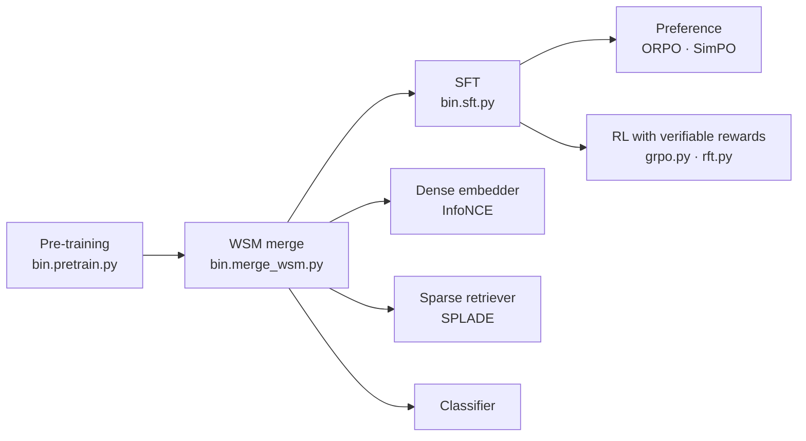

# `training/` · from pre-training to a usable model

One pre-trained decoder feeds every later stage. The chat model, the preference-tuned model and the
retrieval models all start from the same weights, with no second pre-training.



| stage | script | output |
|:--|:--|:--|
| pre-training | [`bin.pretrain.py`](bin.pretrain.py) | causal language model |
| checkpoint merge | [`bin.merge_wsm.py`](bin.merge_wsm.py) | the cooldown of a constant-LR run, done after training |
| growth (beta) | [`bin.upscale.py`](bin.upscale.py) | a model 2× wider computing the same function, trained on with `--init_from` |
| supervised fine-tuning | [`bin.sft.py`](bin.sft.py) | ChatML chat model, loss on assistant tokens only |
| preference | [`bin.preference.py`](bin.preference.py) | ORPO or SimPO, reference-free |
| reinforcement learning | [`grpo.py`](grpo.py), [`rft.py`](rft.py) | GRPO and rejection-sampling fine-tuning with a pluggable verifiable reward |
| distillation | [`bin.distill.py`](bin.distill.py) | online logit distillation, full or top-k |
| dense embedder | [`bin.contrastive.py`](bin.contrastive.py) | `SkylarEmbedder` (InfoNCE, in-batch negatives) |
| sparse retriever | [`bin.sparse.py`](bin.sparse.py) | `SkylarSparseEncoder` (SPLADE-style) |
| classifier | [`bin.classify.py`](bin.classify.py) | `SkylarClassifier` |
| typed decisions (beta) | [`bin.decide.py`](bin.decide.py) | `SkylarDecider`: choice / score / noul with calibrated probabilities |
| optimiser | [`optim.py`](optim.py) | Muon on the hidden matrices, AdamW on the rest |

Every script prints its options with `--help`.

## Pre-training

The trainer streams memory-mapped token shards (uint16 or uint32, see [`data/`](../data/README.md)),
runs on one GPU or many through Accelerate, and resumes after a crash with model, optimiser, RNG and
sampler state.

```bash
# a small model on one GPU
python training/bin.pretrain.py --preset medium --data <tokenized_dir> --tokenizer <tokenizer.json> \
    --seq_len 2048 --batch_size 8 --grad_accum 16 --lr <lr> --warmup <steps> --out checkpoints/medium

# resume where it stopped
python training/bin.pretrain.py ... --resume auto          # = <out>/last, or the newest usable last.prevN
```

`--resume auto` starts from random weights only at a run's first launch: a run that has trained and has no usable
checkpoint stops with an error, and the checkpoint must match the run (model config, tokenizer, `--seed`, the
`--data_mix` folders).

**The Skylar 2 architecture** is switched on by flags (explained in [`models/`](../models/README.md)); learning rate,
batch and schedule are yours to choose:

```bash
python training/bin.pretrain.py --preset 1B_D --data <tokenized_dir> --tokenizer <tokenizer.json> --seq_len 8192 \
    --kda_ratio 3:1 --attn_res --attn_res_mode block --attn_res_block_size 8 --gated_norm 16 \
    --attn_out_gate perhead --hidden_act situ_glu --optimizer muon --doc_masking --compile ...
```

`--doc_masking` is required with recurrent layers: without document boundaries the recurrent state would
flow from one packed document into the next, so the trainer refuses to start.

| feature | flags |
|:--|:--|
| data | memory-mapped shards with SHA-256 checksums; sampler without repeats (`--sampler permutation`); several tokenized folders with weights (`--data_mix`); best-fit packed windows (`--pack keep|drop`, [`data/`](../data/README.md)) |
| chained runs | `--sampler_state <checkpoint>`: a run started with `--init_from` continues the data of an earlier run (every folder goes on with its shuffled passes, a new folder starts at its first window); every save writes a small `sampler_state.json` for it. A full checkpoint given to `--init_from` without it is refused, since its folders would be read again from the first window (`--sampler_fresh_ok` accepts that) |
| schedules | `--lr_schedule cosine`, `wsd` (warmup-stable-decay), `constant` |
| checkpoint merge | with `--lr_schedule constant`, weight-only snapshots every `--wsm_every_tok` tokens or inside `--wsm_window START:END:EVERY`, then `bin.merge_wsm.py` |
| memory | loss computed in chunks, so the full logits never exist at once; activation checkpointing (`--grad_ckpt`) |
| checkpoints | Hugging Face format, `last` plus milestones (`--milestones`), `--keep_last N`, optional async upload to S3 |
| telemetry | `metrics.jsonl`, `train_steps.jsonl`, `status.json`, `heartbeat.json`; GPU power and energy from NVML (`--telemetry_s`); bits per byte on a set of frozen texts (`--bpb_set`); the model's continuation of fixed prompts (`--samples_prompts`); optional W&B (`--wandb`) |
| long runs | `--deadline` and SIGTERM/SIGUSR1 save `last` and exit cleanly; `--ckpt_every_min`; a non-finite gradient skips the update and `--max_nonfinite` stops the run without overwriting `last`; `--skip_tokens_at` resumes from an earlier checkpoint and steps over the data that followed it |
| optimiser | `--wd` on the matrices; `--wd_embed` for the token embedding |
| output logits | optional z-loss on the softmax (`--z_loss C`: C · log Z² per labelled token; `--z_loss_floor F`: only above log Z = F; 0 = off); each evaluation logs the largest logit, log Z, and the mean and spread of the logits |
| validation | a fixed set per data folder (`--val_windows`), the same for any number of GPUs |

### More than one GPU

```bash
# one node
accelerate launch --num_processes 4 --mixed_precision no training/bin.pretrain.py ...

# several nodes, run on each node
torchrun --nnodes $NUM_NODES --node_rank $NODE_RANK --nproc_per_node 4 \
    --master_addr $MASTER_ADDR --master_port $MASTER_PORT \
    training/bin.pretrain.py ... --resume auto
```

- **`--mixed_precision no` is deliberate.** bf16 is applied by the trainer around the forward pass;
  Accelerate's bf16 path would cast the full logits to fp32.
- **`--ckpt_per_node`** makes every node write its own `<out>/last`, for clusters without a shared disk.
- **Resume on a different number of GPUs:** the sampler position is counted in samples, so a run can continue
  on more or fewer GPUs without repeating or skipping data.
- **`--ddp_comm bf16`** halves the gradient traffic between nodes; `--dist_timeout_min` turns a hung
  collective into an error.

## Checkpoint merge

```bash
python training/bin.merge_wsm.py --snapshots_dir <out>/wsm --window_tok <tokens> --method mean --out <out>/merged
```

A uniform average of consecutive checkpoints of a constant-LR run is equivalent to a linear decay over that
window (WSM, arXiv 2507.17634), so the cooldown is chosen after training.

## Growing a model (beta)

```bash
python training/bin.upscale.py --model <out>/last --out <grown>
python training/bin.pretrain.py --init_from <grown> --data <tokenized_dir> ... --resume auto
```

`bin.upscale.py` makes the model twice as wide (d_model, heads, KDA heads, d_ff; same depth and vocabulary) with the
same function and checks it on a batch before writing; `--init_from` starts a run from it. How it works:
[`models/growth.py`](../models/growth.py); gates: [`eval/bin.gate_growth.py`](../eval/bin.gate_growth.py).

## Supervised fine-tuning

```bash
python training/bin.sft.py --base_model <pretrained_dir> --data sft_train.jsonl --epochs <n> --lr <lr> --bf16
```

| feature | detail |
|:--|:--|
| format | ChatML (`<\|im_start\|>role … <\|im_end\|>`) |
| loss mask | only assistant tokens and the closing `<\|im_end\|>` carry gradient; an assistant message with `"train": false` stays in the context without loss |
| stopping | extra weight on `<\|im_end\|>`, so the model learns to end its turn |
| optimiser | AdamW or Muon (`--optimizer`) |
| batches | `--batch_size` rows, or `--max_batch_tokens N`: as many whole examples as fit in N padded tokens, a long one alone (one process); `--group_by_length` puts examples of similar length together (less padding, same loss); `--pad_multiple` rounds batch lengths up, so length-specialised kernels (the KDA ones of the hybrid) are not re-tuned for every new length |
| tokenization | `--tokenize_workers` tokenizes the dataset in parallel; `--tokenized_cache DIR` keeps the tokenized samples, and the next run with the same data, tokenizer, chat template, `--seq_len` and `--overlong` policy reads them back (needs `--val_data`) |
| telemetry | the pre-training's run files: `train_steps.jsonl`, `metrics.jsonl`, `heartbeat.json`, `status.json` (also on a crash or Ctrl-C), GPU telemetry |
| hardware | on B200 the cuDNN attention backend is off (it builds a new plan for every sequence length); flash and memory-efficient attention stay on |

## Reinforcement learning

[`grpo.py`](grpo.py) and [`rft.py`](rft.py) take the reward and the prompt builder from the caller, so the same
loop serves any verifiable task:

```python
from training.grpo import grpo_train, GRPOConfig
grpo_train(model, tok, records, reward_fn, build_prompt,
           GRPOConfig(steps=<n>, group=<k>, grad_ckpt=True, bf16=True, save_every=<m>, out_dir="runs/grpo"))
```

| feature | detail |
|:--|:--|
| memory | `grad_ckpt` recomputes the policy's forward in the backward (needs dropout 0); with `bf16` on CUDA the reference model is kept in bf16; `pad_multiple` as in SFT |
| long runs | `save_every` + `out_dir` write `<out_dir>/last` (policy, optimiser, step, random state); `grpo_train(..., resume_dir=<out_dir>/last)` continues from it |
| log | per step: mean reward, pass rate, loss, and the time spent in generation and in the reward |
